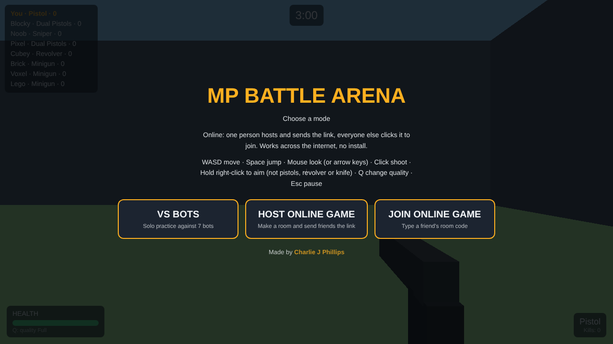
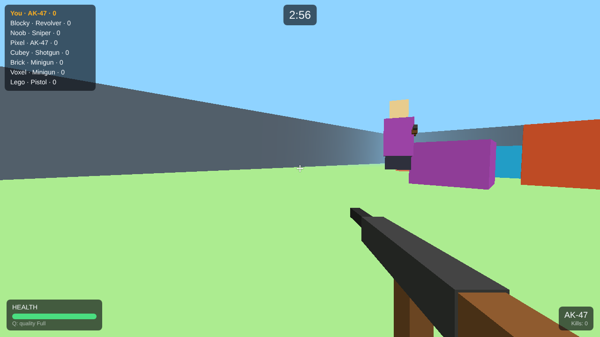
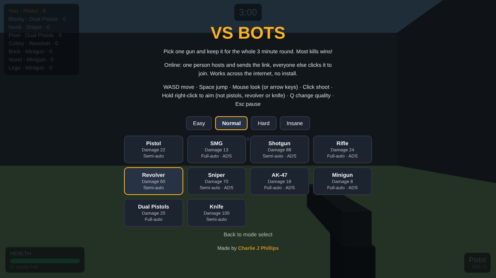
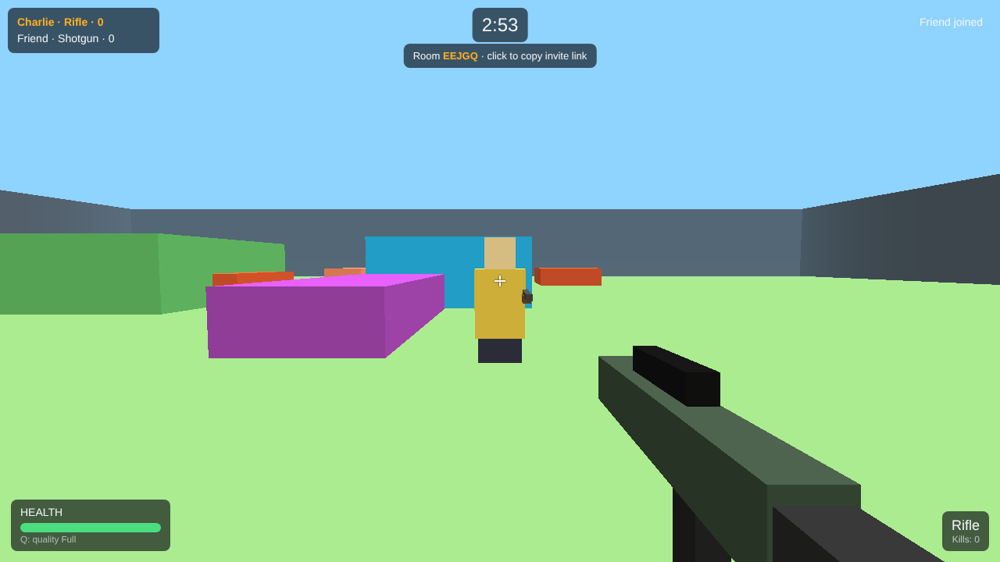

# MP Battle Arena

**Made by Charlie J Phillips**

A 3D blocky shooter that runs in any web browser. Play solo against bots, or play **online with friends**. There's nothing to install and no server to run.

### ▶ [Play now: hardwaremack-prog.github.io/MP-Battle-Arena](https://hardwaremack-prog.github.io/MP-Battle-Arena/)

## Screenshots

**Battling bots with the AK-47**

**Pick your gun and bot difficulty**

**Online match: the room code at the top copies the invite link**

## Online multiplayer
1. One person clicks **HOST ONLINE GAME**. They get a 5-letter room code. Clicking the room box at the top copies the invite link.
2. Friends open the link and click **JOIN ROOM**, or click **JOIN ONLINE GAME** and type the code.
3. Everyone picks a gun. Rounds last 3 minutes, and the most kills wins. A new round starts automatically.

The host's browser runs the match, so the host needs to keep their tab open. Players connect peer-to-peer (WebRTC through PeerJS), which works on most home networks. Some strict school or work networks block it.

## Guns
Pistol · SMG · Shotgun · Rifle · Revolver · Sniper · AK-47 · Minigun · Dual Pistols · Knife

## Controls
WASD move · Space jump · Mouse look (or arrow keys) · Click shoot · Hold right-click to aim · Q change quality · Esc pause

---
Made by Charlie J Phillips
